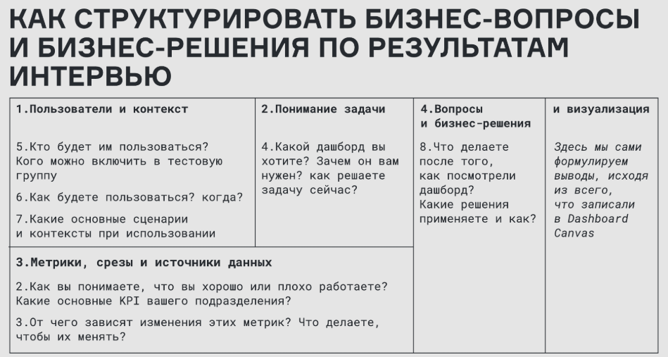

# Кейс: Разработка дашборда для команды листинга (Dashboard Canvas & Dashboard)

## 🎯 Задача
Команда листинга вручную выгружает данные для еженедельных встреч. Нужен **единый дашборд**, который закроет основной сценарий (еженедельный мониторинг) и дополнительные (ежедневный контроль при запусках и форсмажорах, ежемесячные отчёты для CPO/CEO).

**Цель:** провести интервью с заказчиком, собрать требования, структурировать их в Dashboard Canvas, а затем создать сам дашборд.

## 🛠 Что было сделано

### 1. Интервью с заказчиком (Сбор требований)
Провела встречу с представителем команды листинга и зафиксировала ответы на ключевые блоки Dashboard Canvas:

### 2. Проектирование и разработка
*   **Dashboard Canvas:** Заполнила фреймворк на основе ответов интервью (`dashboard_canvas.pdf`).
*   **Дашборд:** Реализовала интерактивный дашборд, опираясь на требования заказчика. Дашборд разделен на две логические части, чтобы закрыть разные сценарии использования:
  *   **А. Оперативная информация на дату отчета (верхний блок)** позволяет увидеть значения текущего периода по трём ключевым KPI и отклонения от предыдущего значения в различных разрезах. Справа расположена таблица «ТОП городов по изменению KPI», которая помогает находить регионы с потенциальными проблемами. Цветовая индикация всех отклонений ускоряет этот процесс.
  *   **Б. KPI за выбранный период (нижний блок)** закрывает потребность в анализе динамики с учетом выбранной гранулярности (месяц, неделя, день), позволяет видеть сравнение с прошлым годом, а также дополнительные метрики.

**🎨 Особенности дизайна и эргономики дашборда:**
*   **Единая цветовая логика:** Вся цветовая гамма подчинена единой системе. Для каждого из трёх ключевых KPI на всех графиках (в обеих частях) использован свой уникальный оттенок синего. Данные за прошлый год выделены контрастным оранжевым. Это позволяет глазу мгновенно находить нужный показатель и отслеживать связь между блоками.
*   **Управление вниманием:** Самые важные метрики расположены в **левом верхнем углу** — зоне первичного внимания. При этом «слепая зона» (нижний правый угол), которая обычно замечается хуже, компенсируется за счёт размещения там крупной и визуально привлекательной **древовидной диаграммы (Treemap)**.
*   **Учет особенностей данных:** Учтена их неаддитивность: значения фильтруются по нужному скейлу, усредняются при выборе нестандартного периода, а также фильтруются по городам для детального анализа всех показателей в отдельном регионе.

## 🧰 Инструменты
*   **Holst** — визуализация макета (Dashboard Canvas).
*   **Yandex DataLens** — разработка и настройка дашборда.

## 📈 Результат
*   Проведено интервью и собран бриф заказчика (`Команда листинга.txt`).
*   Создан **Dashboard Canvas**, который структурирует бизнес-вопросы и решения.
*   Разработан **готовый интерактивный дашборд**, который закрывает все основные сценарии, позволяет углубиться в детали и сократить время на подготовку к еженедельным встречам с нескольких часов ручной работы до нескольких минут.

## 📂 Материалы
*   🔗 **[Интерактивный дашборд в DataLens (публичный доступ)](https://datalens.yandex/1613uob0dxskk?_share_link=public)**
*   📄 **[Dashboard Canvas (PDF)](./dashboard_canvas.pdf)** — структура и логика отчёта.
*   🖼️ **[Скриншот готового дашборда (PNG)](./dashboard_image.png)** — итоговый вид.
*   📊 **[Исходные данные (CSV)](./raw_data.csv)** / **[Excel](./raw_data.xlsx)** — сырые данные.
*   📝 **[Бриф заказчика](./Собранная%20информация%20от%20заказчика.docx)** — требования заказчика и особенности данных.
